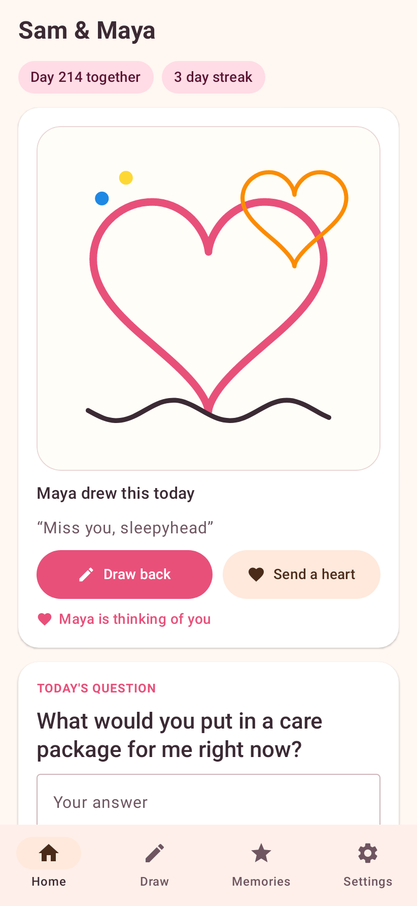
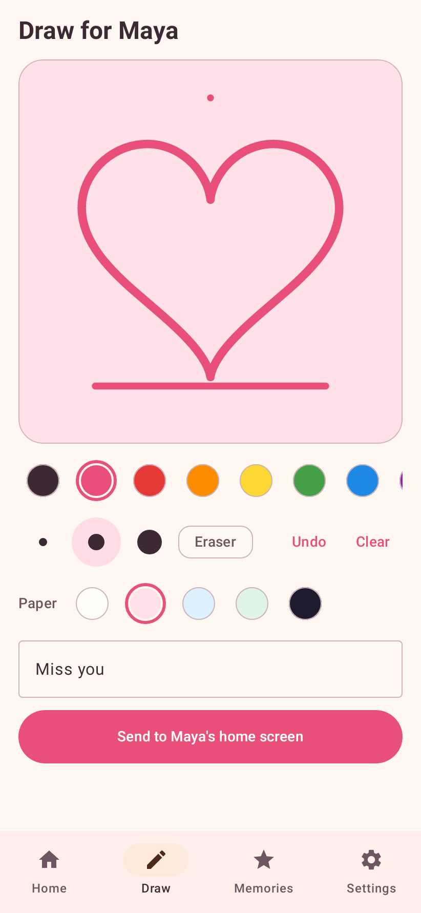
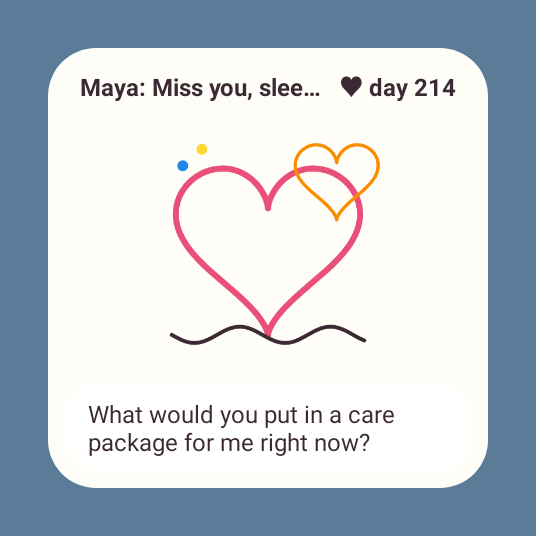

# CuteKind

A home-screen widget for long-distance couples. One of you draws, and the drawing shows up
in a widget on the other's phone, next to a daily question for the two of you.

Android, Kotlin, Jetpack Compose. No account and no server of your own needed.

| Home | Draw | Widget |
|---|---|---|
|  |  |  |

## How it works

1. One partner taps **Start a new couple** and gets a 12-character couple code.
2. The other installs the app, taps **Join my partner** and types the code.
3. Draw something and tap **Send**. It appears in your partner's app and on their widget.

Sync goes through an [ntfy](https://ntfy.sh) relay (changeable in Settings, self-hosting works).
The couple code never leaves the phones: it derives both the relay topic and an AES-256-GCM key,
so the relay only sees encrypted text. The app checks for new drawings every 30 seconds while
open and about every 15 minutes in the background.

## Features

Every feature has its own switch in **Settings**:

Daily question, spicy questions (off by default), answer-to-reveal, question on widget,
caption on widget, days together, doodle streak, thinking-of-you hearts, stroke replay,
memories gallery, notifications, background sync.

## Build

```
./gradlew assembleDebug          # APK in app/build/outputs/apk/debug
./gradlew recordRoborazziDebug   # run tests and re-render app/screenshots
```

GitHub Actions does both on every push and attaches the APK and the screenshots to the run.
